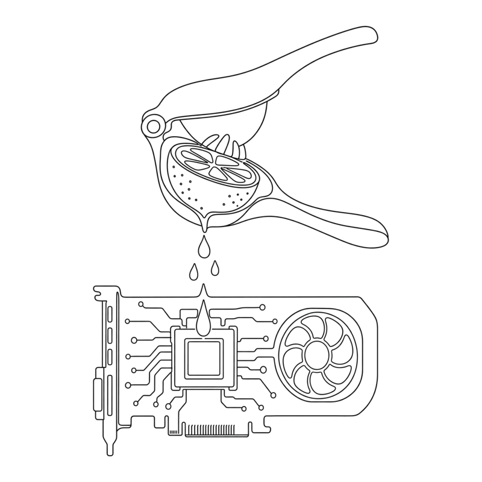

<table border="0" cellspacing="0" cellpadding="0">
<tr>
<td width="220" valign="middle">
<picture>
<source media="(prefers-color-scheme: dark)" srcset="docs/assets/logo-dark.png">

</picture>
</td>
<td valign="middle"><h1>L&nbsp;E&nbsp;M&nbsp;O&nbsp;N &nbsp; S&nbsp;Q&nbsp;U&nbsp;E&nbsp;E&nbsp;Z&nbsp;E&nbsp;R</h1></td>
</tr>
</table>

**How much can you squeeze out of an LLM?**

A reproducible study of what actually makes a language model *finish real coding work*. We hold the prompts and rubrics fixed and vary the four things you actually control:

> **model** x **harness** x **config** x **venue**

...and we score every run by *running the code it produced*, not by vibes. The point is the squeeze: the most useful work per dollar, per watt, and per gigabyte of VRAM.

## Four venues

| | Local (4070) | Local (M4 Max) | Local (Mac Studio) | Cloud |
|---|---|---|---|---|
| Hardware | RTX 4070 Super, 12 GB | M4 Max, 48 GB unified | M5 Max, 128 GB unified (120 GB GPU limit) | rented on [OpenRouter](https://openrouter.ai) |
| Cost | electricity (~kWh) | electricity (~kWh) | electricity (~kWh) | API fees (~$/task) |
| Privacy | total, offline | total, offline | total, offline | none |
| Model ceiling | ~14-30B (quantized) | ~70B+ | ~120B MoE at Q4, 235B at 3-bit | 480B+ frontier-open |
| Engine | Ollama | Ollama | llama.cpp (`llama-server`) | provider |
| Benchmark | coding suite | coding suite | agentic tool calling | coding suite |
| Runner | `bin/eval-run` | `bin/eval-run --host m4max` | separate harness; rows in [`studio/`](studio/) | `bin/cloud-run` / `bin/cloud-matrix` |

On the coding suite it is the same agent, same tasks and same scoring for the 4070, the M4 Max and the cloud, so model-vs-model, harness-vs-harness and local-vs-cloud are honest comparisons there. (The M4 Max venue has 3 smoke runs so far; a real sweep is on the [roadmap](ROADMAP.md).) The **Mac Studio** runs a different benchmark: big local models as tool-calling agents on files, mail, messages and an intranet, scored on the end state. Its scores do not compare with the coding suite's. See [FINDINGS-STUDIO.md](FINDINGS-STUDIO.md).

## What we have found so far

These are real but **early**, and we are deliberate about not overclaiming (see *Honesty* below).

- **The harness can matter more than the model.** A controlled cloud bake-off (same model, same evals, only the harness changes), compared on the cells where *both* harnesses ran, shows aider beating our `squeezer` loop overall (79.7% vs 46.8% on the paired cells) - and the gap explodes on weak models: `qwen3-coder-30b` goes **7% (squeezer) -> 76% (aider)**, `llama-3.1-8b` **12% -> 74%**, on identical weights. Strong models tie (gpt-oss-120b and deepseek-v4-flash both 100% either way). Weak models are rescued by the right harness. See [FINDINGS-CLOUD.md](FINDINGS-CLOUD.md).
- **For the cloud "which open model" question:** a cluster of cheap open models (deepseek-v4-pro/flash, qwen3-max, glm-5.1, kimi) lands in the high 90s on our suite with overlapping confidence intervals (a tie, not one winner), and the value pick `gpt-oss-120b` gets ~92% for about **$0.0007 per task**. Multi-model *mixes* mostly do not beat the best single model; they are a **weak-model rescue kit**, not a ceiling-raiser. Full writeup: [FINDINGS-CLOUD.md](FINDINGS-CLOUD.md).
- **Reasoning models underperform at agentic coding** here, and "coding-specialist" models did not beat strong generalists.
- **Big local models as agents (Mac Studio, exploration; final pass pending).** On 37 tool-calling tasks Edge0-145B and Qwen3.8-Flash-Next both solved 37/37 and both solved all 15 of a harder set; five more models sit at 33-34/37. Giving the agent a `run_python` tool was the biggest lever (+17 tasks over 4 models on 35 shared tasks, 95% CI +3 to +33). Abliteration (gpt-oss-120b vs its heretic) did not change the solve count (29 = 29), though the heretic obeyed a planted prompt injection the base ignored; MLX vs llama.cpp on gpt-oss-120b was 29 vs 31 at equal speed, too wide to call. About half the first day's failures were harness bugs (a grammar that forces schema key order, a mail mock that ignored parentheses, a jail that could read the answers, a world clock that disagreed with the host's); all twelve are written up. Single trials on a moving harness: a screen, not a ranking. See [FINDINGS-STUDIO.md](FINDINGS-STUDIO.md).

## How it works

Everything runs through one small agent, `bin/squeezer.py`: a ~250-line, dependency-free tool-calling loop (`read_file` / `write_file` / `list_files` / `run_bash`) that talks to any OpenAI-compatible endpoint. Point it at local Ollama or at OpenRouter; only the base URL and model change. It also recovers tool calls from models that emit them as plain text, so it drives local models that stricter harnesses reject.

> **On `squeezer` itself:** it is our *reference* harness (minimal, transparent, hackable), not a claimed best-in-class agent. The controlled cloud bake-off (same models, same evals, eight harnesses incl. aider, pi, cline, codex and claude-code; see [FINDINGS-CLOUD.md](FINDINGS-CLOUD.md)) has aider well ahead of squeezer on weak models and a tie on strong ones. A standard external benchmark to put these numbers on a common ruler is still queued (see [ROADMAP.md](ROADMAP.md)).

```
        prompt.md ──► squeezer agent ──► workspace/ ──► rubric.sh ──► score%
                          (any model, any venue)              runs.jsonl
```

A **mix** (`bin/squeezer_pipeline.py`) wires several models over one workspace: a frontier model plans, a cheap one implements (architect); draft, critique, refine; ensemble-and-judge; or write-tests-and-self-correct (verify).

### Run one task

```bash
# Local, on the 4070:
bin/eval-run aider bug-fix qwen2.5-coder:14b baseline

# Cloud, one open model:
bin/cloud-run dijkstra deepseek/deepseek-v4-pro

# Cloud, a multi-model mix (frontier plans, cheap model implements):
bin/cloud-run dijkstra --pipeline architect \
    --primary-model qwen/qwen3-coder-30b-a3b-instruct \
    --architect-model deepseek/deepseek-v4-pro
```

### Run the whole experiment

```bash
bin/cloud-matrix --trials 4 --budget 80 --concurrency 24   # all arms x suite, budgeted + parallel
bin/cloud-report --tag fable-hunt --by-eval                # leaderboard: score, $/task, score-per-$
bin/energy-report --watts 250 --price 0.15 --by-model      # local electricity: kWh + cost
```

The arms under test live in [`configs/cloud-arms.json`](configs/cloud-arms.json) (currently 26 single models + 13 mixes). The cloud suite there is 39 tasks (port-scanner, the 40th, was dropped as environment-dependent), with a separate 10-task hard tier.

## Eval anatomy

Each eval is `evals/<name>/`: a `prompt.md` (the task), a `rubric.sh` (runs the produced code, prints `{checks, score_pct}`), and an optional `files/` of starter code. Rubrics weigh **runtime correctness** over structure: a program that looks right but returns wrong answers loses most of its points. The suite spans algorithms (dijkstra, huffman, regex-engine), numerics (kalman-filter, fft), systems (rate-limiter, lru-cache), and multi-file "read-an-existing-codebase-and-change-it" tasks (bug-fix a ledger library, add CLI subcommands, refactor, build a state machine from spec).

## Honesty

The results are only as good as the method, and we are explicit about the current limits (and the fixes, in [ROADMAP.md](ROADMAP.md)):

- **Rubric integrity (fixed 2026-06-15).** An adversarial review found 26 rubrics that could score a non-working stub at 100% (an import error dropped the behavioral checks and collapsed the denominator). All 26 were rewritten so every check always emits, and **all 2,894 affected runs were re-scored**; some scores correctly dropped. Details in [ROADMAP.md](ROADMAP.md#0-integrity-audit---2026-06-15-codex-adversarial-review).
- **Stats.** `cloud-report` aggregates per eval first (trials of one eval are correlated) and reports a cluster-bootstrap 95% CI; the dashboard ranks by means with low-coverage rows pulled toward the mean, so one lucky run can't top the table.
- **Sampling is not yet pinned by default** (`--temperature/--seed` exist; the next canonical sweep will use them), so older single-trial scores carry noise.
- **No sandbox yet.** The agent's `run_bash` could read a rubric mid-run (a contamination vector, not yet observed); real isolation needs a container. API keys are scrubbed from the agent shell.
- **Home-field bias.** Until a standard external benchmark (aider-polyglot / SWE-bench-lite) runs, treat "best on our suite" as exactly that.

## Repo map

```
bin/
  squeezer.py / squeezer_pipeline.py   # the agent + multi-model mixes
  eval-run                             # local runner (Ollama), GPU-locked + telemetry
  cloud-run / cloud-matrix             # cloud runner + budgeted parallel sweep
  cloud-report / energy-report         # leaderboard ($) + electricity (kWh)
  studio-pull / studio-summary         # Mac Studio tool-calling rows -> studio/summary.json
  studio-refresh [--pr]                # both, plus a PR, once the final pass lands
evals/<name>/        # prompt.md + rubric.sh (+ optional files/)
configs/cloud-arms.json   # the experiment design (models + mixes)
runs.jsonl           # one JSON per run, the source of truth
studio/rows/         # Mac Studio tool-calling rows, one JSON per task (separate benchmark)
dashboard-next/      # Next.js dashboard -> GitHub Pages (/ local, /cloud cloud)
ROADMAP.md           # where this is going
```

## Site

Live at [noahjohnson0.github.io/lemon-squeezer](https://noahjohnson0.github.io/lemon-squeezer/): the lab's publication. The home page lists the current findings, each with its evidence and an honesty label (exploration, final pass pending, too wide to call); `/studies/` has one page per study (method, results with intervals, limitations, data); `/methods/`, `/data/` (sanitized downloads) and `/about/` complete it. Every number is computed at build time from `runs.jsonl` and `studio/summary.json` (`dashboard-next/src/lib/site-data.ts`). The old `/local`, `/cloud` and `/studio` URLs redirect to the matching study.

## License

MIT.
